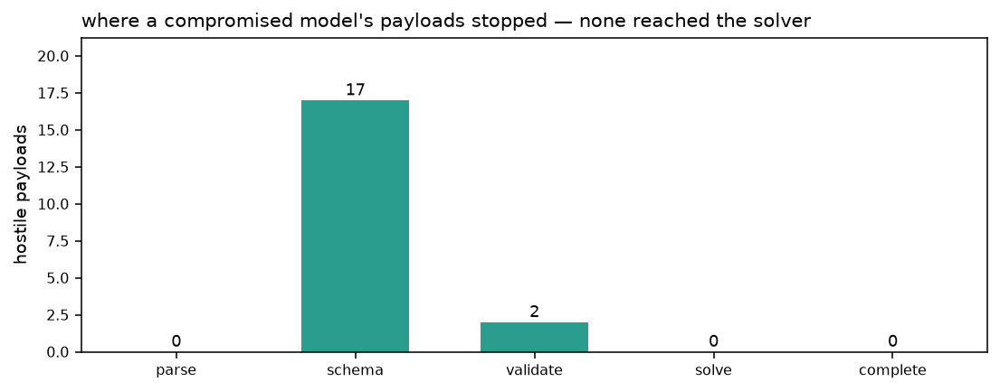
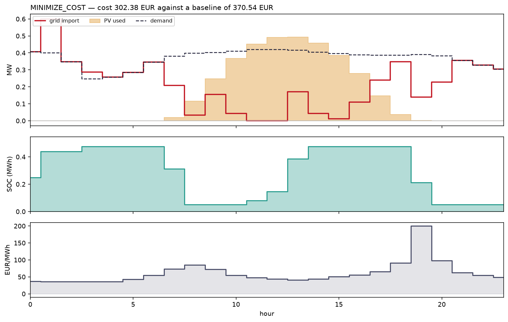
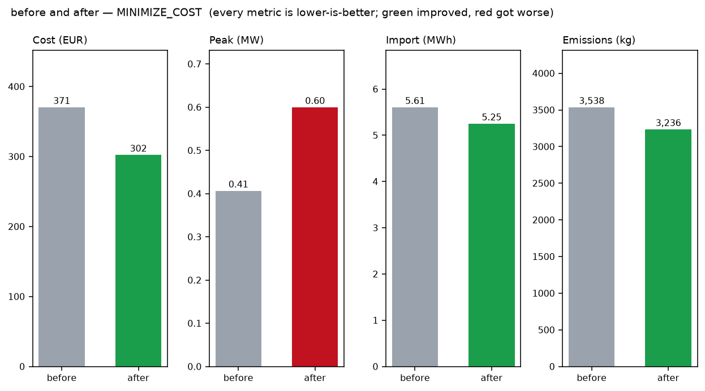
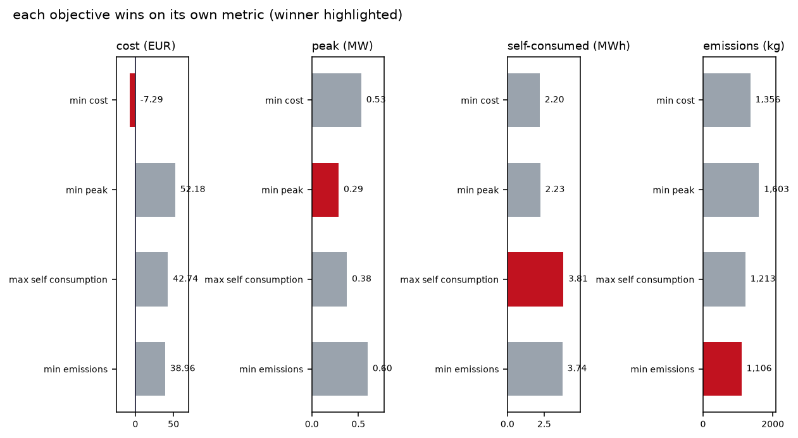
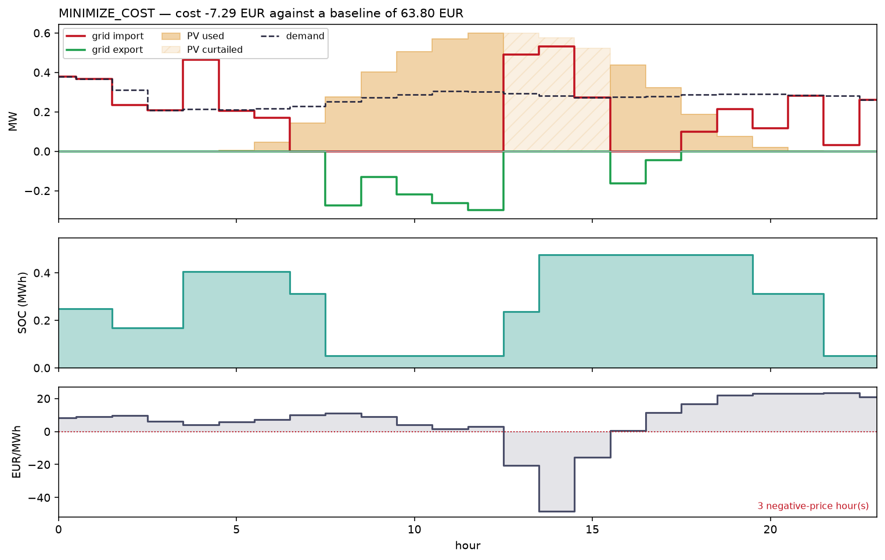
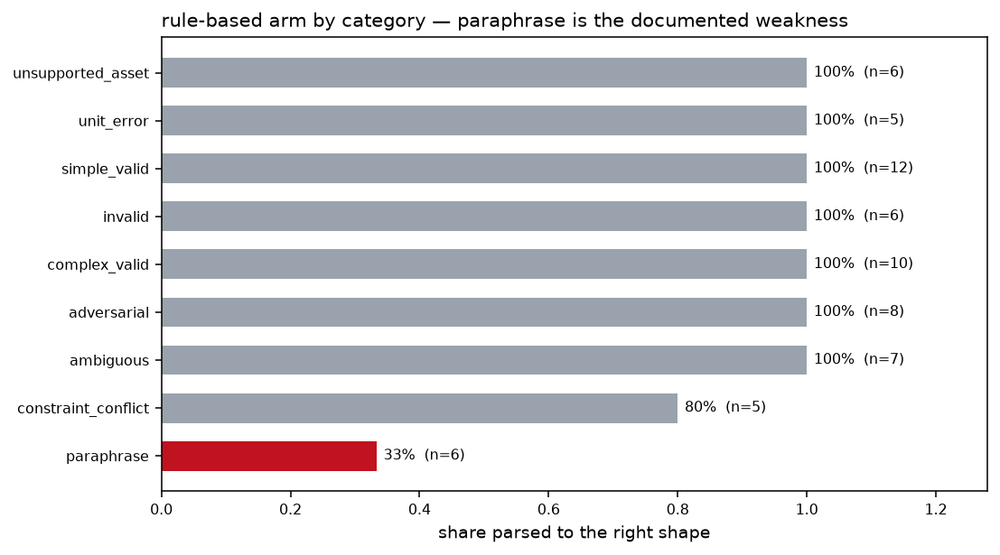

# LLM-to-Energy Optimization Copilot

Natural-language energy requests turned into a **validated structured intent**,
solved by a deterministic Pyomo optimizer, and explained from the numbers the
optimizer produced.

The LLM interprets and explains. It never decides physics, never decides
economics, never calculates a saving, and never reaches a solver except through
a schema that has to accept it first.

```
request ─▶ parse ─▶ schema ─▶ validate ─▶ build ─▶ solve ─▶ KPIs ─▶ explain
              │        │          │                            │        │
          language  meaning  this site's        arithmetic, in Python   │
                             equipment                                  │
                                                        checked against ┘
                                                        every number quoted
```

Each stage is named, and every response records **which stage it stopped at**.
That field is how the central claim below stops being rhetoric.

---

## The claim: the prompt is not the security boundary

§21 of the brief asks for prompt-injection tests. The weak way to satisfy that
is to show a well-behaved model declining a nasty request — which establishes
almost nothing, because it tests the model's manners on the day it was asked.

So every security test here drives the pipeline with `CompromisedProvider`: a
model **wholly under an attacker's control**, which ignores the system prompt
and returns the attacker's payload every single time.

Nineteen hostile payloads. **None reached the solver.**



| Layer that refused | Count |
|---|---:|
| schema | 17 |
| validator | 2 |
| **parser / prompt** | **0** |

Zero were stopped by the parser's judgement. Every one died in a layer that has
never seen a prompt and cannot be talked round — which is the difference between
a system that is safe and a system whose model was in a good mood.

**Two payloads are deliberately allowed through**, and that is the correct
behaviour. A `notes` field containing `__import__('os').system('rm -rf /')` is a
note containing some characters: nothing here evaluates a string, looks up an
attribute by one, or interpolates one into a query. Blocking it would mean
claiming credit for defeating something that was never an attack, and would push
the design towards filtering alarming-looking text rather than towards making
text inert — which is the property that survives rephrasing.

---

## What the copilot does



> *"Reduce electricity cost tomorrow while keeping battery SOC above 20%."*

Parsed to `MINIMIZE_COST | horizon=tomorrow | minimum_soc_frac=0.2`, validated
against the site, solved, and explained:

> Optimising for minimising cost moves the day's cost from 370.54 EUR to 307.92
> EUR, a change of 62.62 EUR. The battery charges in 6 hour(s) at an average
> price of 41.39 EUR/MWh and discharges in 4 hour(s) at an average of 114.09
> EUR/MWh. Peak import rises from 0.407 MW to 0.600 MW, which is the cost of
> buying hard in the cheap hours.

Every figure in that paragraph came out of a KPI dictionary, and a check
confirms it: see [explanations](#are-the-explanations-grounded) below.

**The trade-off is shown, not hidden.** Optimising cost *raises* the peak by 47%
— buying hard in cheap hours is what that costs — and the before/after figure
colours it red rather than painting every "after" bar as an improvement.



### Four objectives that are genuinely four things



An objective that cannot move its own metric is decorative, and a test requires
each to win on its own. That test caught a real defect: with PV at 0.30 MWp the
array **never once exceeded demand** across all 360 committed hours, so every
kWh of sun was self-consumed whatever the optimizer did,
`MAXIMIZE_SELF_CONSUMPTION` was a constant, and its "optimum" was an arbitrary
vertex that happened to post the worst cost of the four. At 0.60 MWp there are
24 surplus hours and 2.61 MWh to place.

---

## Five defects found by measuring

Every one produced plausible output, and most passed a green test suite first.

### The binaries are necessary here — the opposite of the sibling repo's finding

`forecast-driven-bess-dispatch` measured that a cost-only battery LP needs no
binary forbidding simultaneous charge and discharge: round-trip losses already
make it wasteful. That reasoning does not survive here. Built as a pure LP,
**5 of 60 solves** across 15 days and 4 objectives came back physically absurd,
for two unrelated reasons:

**Negative prices invert the export discount.** On 2020-06-01 hour 15 the price
is −15.47 EUR/MWh. Importing therefore *earns* 15.47 and exporting *costs* 90%
of it — so importing and exporting the same megawatt-hour nets **+1.55 EUR/MWh**
through a meter that physically cannot do both. This is the mirror image of the
tariff bug project 01 caught, and guarding `export_price_ratio <= 1` closes only
the positive-price half of it.

**Three of the four objectives never mention the battery.** Cycling is not
unprofitable under them, merely *unpenalised*, which is enough: the solver
returned a schedule charging 0.250 MW and discharging 0.226 MW in the same hour.

Two binaries per hour fix it at 2.3× the solve time (38.9 ms → 91.4 ms). The
broken LP mode is **kept and demonstrated failing**, so the justification stays
checkable.



That is the day it was found on: three negative-price hours in the afternoon,
and a bill that ends at **−7.29 EUR** — the site is paid to consume. The
percentage saving on such a day is reported as a flag rather than a ratio,
because "111% saving" is arithmetically correct and close to meaningless as
prose.

### A parse that was valid and simply not what was asked

`"Shift flexible loads away from peak-price hours"` matched the peak-*demand*
pattern before the price one and produced `MINIMIZE_PEAK`. The intent was
well-formed, passed the schema, passed the validator, and solved. **Nothing
downstream can catch an intent that is valid and wrong** — which is the whole
reason the benchmark exists.

### Seven prompts that silently dropped a limit the user stated

The first benchmark run had 14 failures, and half were the same shape:
`"cap import at 200 MW"` produced a confident intent **with no import cap in
it**. The operator is told their request was carried out and their number has
evaporated.

The fix is general rather than pattern-by-pattern: **refuse when the request
contains a quantity the parser did not consume.** A parser that cannot use a
number you gave it has not understood you.

Three more of that family: `"never let the battery go below 99%"` was read as a
*maximum* of 99%; `"Lower the peak and hold export under 100 kW"` let the peak
pattern reach across the clause and cap total import at 100 kW on a site whose
load alone exceeds it — a well-formed request producing an infeasible model, the
least debuggable pair of properties a parse can have.

### An update path that skipped the schema

Both conversation merge paths used `model_copy(update=...)`, which **does not
validate**. It left a raw string where an enum belonged and surfaced three
frames away. In a system whose entire claim is that nothing reaches the
optimizer unvalidated, the update path is the one place that must not bypass the
schema.

### A crash no test could see

A site with no battery gets `charge`, `discharge` and `soc` bounded to (0, 0);
HiGHS presolves them away; reading their values raises. Every battery-*having*
path worked, so 272 tests missed it — it appeared only when a scenario
comparison removed the battery.

---

## Are the explanations grounded?

§20 asks for explanation factuality as a measured quantity. The obvious approach
is to ask a second model whether the first was honest, which replaces a question
about arithmetic with a question about a second model's opinion.

This extracts every number from the explanation and requires it to appear in the
structured result, matched at the precision the text used. **0 ungrounded across
60 runs** of the deterministic renderer; fabricated magnitudes — `74.00 EUR`,
`0.123 MW`, `99.5%` — are caught.

The checker's first act was to falsify a claim in its own repository:
`describe()` said it was "grounded by construction" while quoting average charge
prices it had computed itself and put in no fact sheet. It scored **0.78**.

**What the check does not catch, stated plainly** — because a guarantee nobody
bounds is a guarantee nobody can rely on:

- **Fabricated small integers.** `"the battery cycled 12 times"` passes, because
  12 is inside the hour allowance. It polices magnitudes, not counts below 25.
- **Correct numbers assembled into a false claim.** Nothing here reads meaning.

A factuality score of 1.0 means *no invented magnitudes*. It does not mean true.

---

## The benchmark

65 prompts across 9 categories, each carrying the outcome it should produce, so
both arms are scored against the same standard rather than against each other.



| Metric | Rule-based arm | LLM arm |
|---|---:|---|
| Right shape (intent / clarification / rejection) | **92.3%** | *unmeasured* |
| Right detail, where an intent was expected | **86.2%** | *unmeasured* |
| Safety — never reached the solver, 19 prompts | **100%** | *unmeasured* |

**Safety is reported separately and never averaged into accuracy.** A system
that refused everything would score 100% on safety and be useless.

### Why there is a rule-based arm at all

It is a genuine parser, not a mock. Without it, an accuracy figure for the LLM
answers only "did it run"; with it, the question becomes **what the LLM adds
over pattern matching** — the same question `forecast-driven-bess-dispatch`
asked about forecasts. It also means CI reports a real, reproducible number with
no key, no network and no billing account.

Its weaknesses were **written down before the benchmark was run**, and
paraphrase is one of them. It scores 33% there, and a test *pins it below 0.8*:
fixing that by adding patterns would be overfitting to my own benchmark.

### The LLM arm is unmeasured, not zero

There is no API key in the environment this was built in, and CI has none — nor
should CI hold a billing credential to run a test suite. So the LLM arm has
never been asked anything, and reporting 0% would be a claim about a model that
never ran.

`evaluations/record.py` refuses to invent responses in its place. Set a key, run
it once, and it records what the model actually said into committed fixtures;
after that the arm replays anywhere for free, and a reviewer can read the
recordings rather than trusting a number.

---

## What it is built on

**Data.** Price, load and PV derived once from Open Power System Data, snapshot
`2020-10-06` (the pinned release project 01 documented), scaled to a single
commercial site. The committed CSV holds **15 representative days** chosen by a
documented procedure — widest and narrowest price spread, sunniest, dullest,
most negative-price hours, cleanest and dirtiest grid, plus typical days. A
dataset of comfortable days would flatter the optimizer.

**Carbon intensity is a proxy and is labelled one.** OPSD carries load, solar
and wind and **no fossil generation by fuel**, so a true fuel-mix intensity is
not derivable from it — checked before the emissions objective was designed.
What is computed is `fossil_share × 700 gCO₂/kWh`, an assumption of this project
in the way project 03 labelled the line ratings its source did not provide.

**Nothing touches the network at runtime.**

---

## Install and run

```bash
pip install -e ".[solvers,viz,dev]"
pytest -v
```

The benchmark, offline:

```bash
python evaluations/run_eval.py
```

The app:

```bash
streamlit run app/streamlit_app.py
```

Figures:

```bash
python scripts/make_figures.py
```

With a real model, once:

```bash
pip install -e ".[llm]"
ANTHROPIC_API_KEY=... python evaluations/record.py
python evaluations/run_eval.py --arms both
```

---

## Architecture

```
src/energy_copilot/
  domain/          site configuration, ontology, units that refuse to guess
  schemas/         the strict intent — the gate between prose and arithmetic
  validation/      is it possible AT THIS SITE; never sees a prompt
  optimization/    Pyomo builder and solver; accepts only validated structures
  parsing/         two arms, one interface, so the comparison is a comparison
  llm/             providers and versioned prompts; all optional
  explain/         explanations, and the check on every number in one
  kpis.py          §14 arithmetic, in Python, never in the model
  pipeline.py      the stages, and which one a request stopped at
  conversation.py  multi-turn state kept separate from the transcript
  observability.py one record per request; redacts anything key-shaped
```

---

## Limitations

- **The LLM arm's real-model accuracy is unmeasured.** Stated in those words
  rather than implied by a number.
- **Factuality is a floor, not a proof.** No invented magnitudes ≠ true.
- **The carbon figures are a proxy**, not grams of CO₂ in Germany.
- **One day at a time.** Horizons beyond 24 hours are refused rather than
  silently truncated.
- **Paraphrase is weak in the rule-based arm** by design, and pinned that way.
- **A simulated decision-support system.** It is not connected to equipment and
  §27's instruction not to connect it is followed.

---

## Companion repos

Eight standalone optimization models built to the same conventions — validated
structures that fail loudly at construction, a builder that never touches raw
files, and a result object rather than a live model — but sharing no code.

- [economic-dispatch-pyomo](https://github.com/matinjalali543-lang/economic-dispatch-pyomo)
  — multi-period, multi-bus DC-OPF economic dispatch with ramping, curtailable
  renewables, storage and locational marginal prices.
- [battery-storage-optimization-pyomo](https://github.com/matinjalali543-lang/battery-storage-optimization-pyomo)
  — battery arbitrage co-optimized with frequency regulation capacity as a
  single LP.
- [cvrp-optimization-pyomo](https://github.com/matinjalali543-lang/cvrp-optimization-pyomo)
  — exact MILP for the Capacitated Vehicle Routing Problem, with a measured
  benchmark of where exact methods stop scaling.
- [supply-chain-network-optimization-pyomo](https://github.com/matinjalali543-lang/supply-chain-network-optimization-pyomo)
  — multi-echelon network design and production-distribution-inventory planning
  as one MILP.
- [forecast-driven-bess-dispatch](https://github.com/matinjalali543-lang/forecast-driven-bess-dispatch)
  — ML forecasts feeding a dispatch LP, measuring what the forecast is worth.
  **The closest sibling to this repo**: there the question is what a forecast is
  worth, here it is what a language model is worth, and both are answered by
  scoring against a deterministic control arm.
- [building-energy-digital-twin](https://github.com/matinjalali543-lang/building-energy-digital-twin)
  — an RC thermal twin identified from its own telemetry, with injected faults
  scored by precision and recall.
- [resilient-microgrid-optimization](https://github.com/matinjalali543-lang/resilient-microgrid-optimization)
  — a MILP operating a distribution feeder through a 72-hour extreme event,
  under a radiality constraint enforced rather than asserted.

## License

MIT — see [LICENSE](LICENSE).
